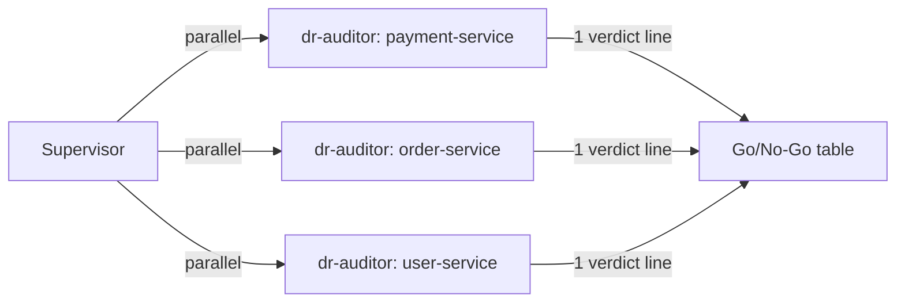

# DR Fleet Audit

> Fans out one `dr-auditor` subagent per service. Each subagent burns its own context window on the verbose healthcheck JSON and returns a single verdict line. The supervisor's context stays clean.

| | |
|---|---|
| **Trigger** | `"audit the fleet"` |
| **Type** | Multi-agent orchestration (Pattern C) |
| **Agents** | `agents/dr-auditor.md` — one instance per service |
| **Output** | One go/no-go table, one row per service |

## Fleet

| Service | Region |
|---|---|
| payment-service | us-west-2 |
| order-service | us-west-2 |
| user-service | us-west-2 |

## Workflow Steps



### 1. Fan out (single message, parallel)

Spawn one `dr-auditor` subagent per service **in the same message** so they run concurrently. Each prompt is exactly: `Audit <service> in <region>.`

### 2. Collect verdicts

Each subagent returns one table row. Do not re-run their healthchecks yourself.

### 3. Synthesize

Assemble the rows under this header and state an overall fleet verdict (READY only if every service is READY):

```
| Service | Region | Verdict | Repl. lag | Last drill | Confidence | Issues |
```

### 4. Report the context win

Close with one sentence: N subagents processed the raw healthcheck JSON in their own context windows; only N verdict lines entered this conversation.

## Why this matters (context management)

Without subagents, N verbose JSON payloads land in the main conversation and stay there for the rest of the session. With fan-out, the supervisor holds ~N lines. This is the same supervisor/worker delegation pattern as CLI Agent Orchestrator (CAO), using the agent framework's native subagents instead of tmux sessions.
